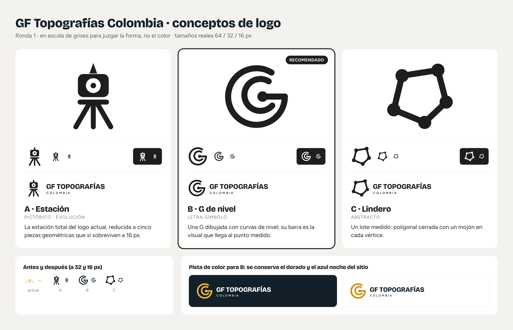

# Logo de GF Topografías Colombia · conceptos (ronda 1)

Propuestas para rediseñar el logo con el método de la skill *logo-design* (github.com/kaankiziltug/logo-design-skill):
brief → diagnóstico → tres conceptos en SVG → pruebas de tamaño → **punto de control**.
Nada de esto cambia todavía el sitio: los archivos de `img/` siguen siendo los actuales.

## Brief (supuestos, porque no hubo entrevista)

- **Quién**: empresa de topografía en Colombia (levantamientos, loteo y linderos, curvas de nivel, fotogrametría, apoyo en obras civiles).
- **Público**: propietarios de lotes, constructoras, ingenieros y entidades que cotizan por WhatsApp.
- **Personalidad**: precisa, confiable, de campo, actual, cercana.
- **Dónde debe funcionar**: encabezado del sitio, ícono de pestaña (16 px), foto de perfil de WhatsApp, chaleco bordado, casco, vinilo de camioneta, planos DWG.
- **Lo que se conserva**: el dorado y el azul noche del sitio, y el nombre «GF Topografías · Colombia».

## Diagnóstico del logo actual

- Es el dibujo de una estación total calcada, con muchos detalles: a 32 px ya es una mancha y a 16 px desaparece.
- Usa degradado: no se puede bordar, sellar ni imprimir a una tinta sin perder la forma.
- La rosa de los vientos marca **W** (en español es **O**) y pone la **S** al lado este, donde va la **E**.
- Es la idea más común del sector (instrumento + brújula): no se distingue de la competencia.

## Conceptos (en negro, para juzgar la forma)

| | Concepto | Tipo | Idea en una frase |
|---|---|---|---|
| A | Estación | Pictórico (evolución) | La estación total del logo actual, reducida a cinco piezas geométricas que sí sobreviven a 16 px. |
| **B** | **G de nivel** (recomendado) | Letra-símbolo | Una G dibujada con curvas de nivel; su barra es la visual que llega al punto medido. |
| C | Lindero | Abstracto | Un lote medido: poligonal cerrada con un mojón en cada vértice. |

- **A** conserva el reconocimiento del logo actual. Riesgo: sigue siendo el instrumento dibujado y puede leerse como cámara o robot.
- **B** es propio (la G de GF), se lee como letra hasta 16 px y conecta con el fondo del sitio, donde las curvas de nivel salen de los puntos medidos.
  Las curvas se juntan arriba a la derecha y se abren abajo a la izquierda, como una ladera. Riesgo: a primera vista puede recordar una diana.
- **C** habla del producto que más se vende (loteo y linderos). Riesgo: la poligonal con puntos también se usa en logos de redes y tecnología.

## Archivos

- `concepto-*-simbolo.svg`: símbolo solo, lienzo 256 × 256.
- `concepto-*-horizontal.svg`: símbolo + «GF TOPOGRAFÍAS / COLOMBIA».
- Las letras ya están convertidas en trazos (Bricolage Grotesque 800 y Figtree 600, licencia OFL, que permite usarlas en un logo); no dependen de fuentes instaladas.

## Siguiente paso

Elegir una dirección (o decir qué gusta de cada una). Con la dirección aprobada se arma el kit completo:
paleta con versión a una tinta e invertida, versiones horizontal y apilada, corte para tamaños pequeños,
favicon e íconos del celular, tablero de presentación con aplicaciones (chaleco, casco, camioneta, plano) y guía de uso de una página.

**Antes de usarlo**: buscar la marca en la Superintendencia de Industria y Comercio (SIC), que lleva el registro de marcas en Colombia,
y hacer una búsqueda inversa de imágenes. Este trabajo no garantiza que el diseño esté libre para registrar.
