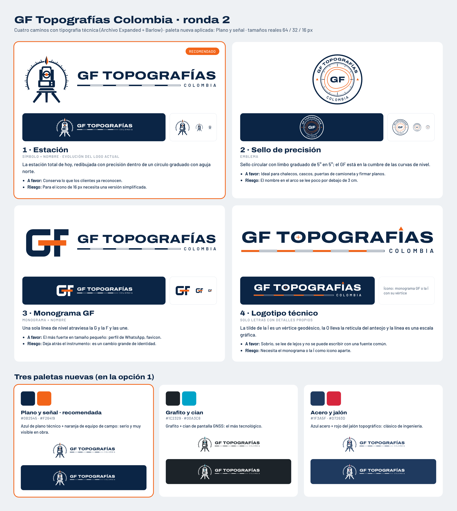

# Logo de GF Topografías Colombia · ronda 2

Respuesta a lo que no funcionó en la ronda 1 (`../conceptos/`): se veían simples o de app, perdían la identidad
actual y las letras eran débiles. Personalidad pedida: ingeniería seria + tecnología de punta. Paleta nueva.

## Opciones

| | Opción | Tipo | Idea |
|---|---|---|---|
| **1** | **Estación** (recomendada) | Símbolo + nombre | La estación total de hoy, redibujada con precisión dentro de un círculo graduado con aguja norte. |
| 2 | Sello de precisión | Emblema | Sello circular con limbo graduado; el GF está en la cumbre de las curvas de nivel. |
| 3 | Monograma GF | Monograma + nombre | Una sola línea de nivel atraviesa la G y la F y las une. |
| 4 | Logotipo técnico | Solo letras | La tilde de la Í es un vértice geodésico, la O lleva la retícula del anteojo y la línea es una escala gráfica. |

La escala gráfica bajo el nombre reemplaza la franja tricolor del logo actual y conserva su lugar (línea + «Colombia» a la derecha).

## Paletas propuestas

| Paleta | Oscuro | Acento | Carácter |
|---|---|---|---|
| **Plano y señal** (recomendada) | `#0B2545` | `#F26419` | Azul de plano técnico + naranja de equipo de campo |
| Grafito y cian | `#1C2329` | `#00A3C8` | La más tecnológica |
| Acero y jalón | `#1F3A5F` | `#D7263D` | Azul acero + rojo del jalón; clásica de ingeniería |

## Tipografía

Archivo Expanded ExtraBold (nombre) y Barlow SemiBold (Colombia), ambas con licencia OFL, que permite usarlas en un logo.
En los SVG las letras ya están convertidas en trazos. Las curvas de nivel, el limbo graduado y la retícula también son rellenos, sin trazos.

## Pendiente para el kit (cuando se elija)

Versión simplificada para 16 px, versiones a una tinta e invertida, versión apilada, íconos del sitio y del celular,
aplicaciones (chaleco, casco, camioneta, rótulo de plano) y guía de uso. Antes de registrar: búsqueda en la SIC.
